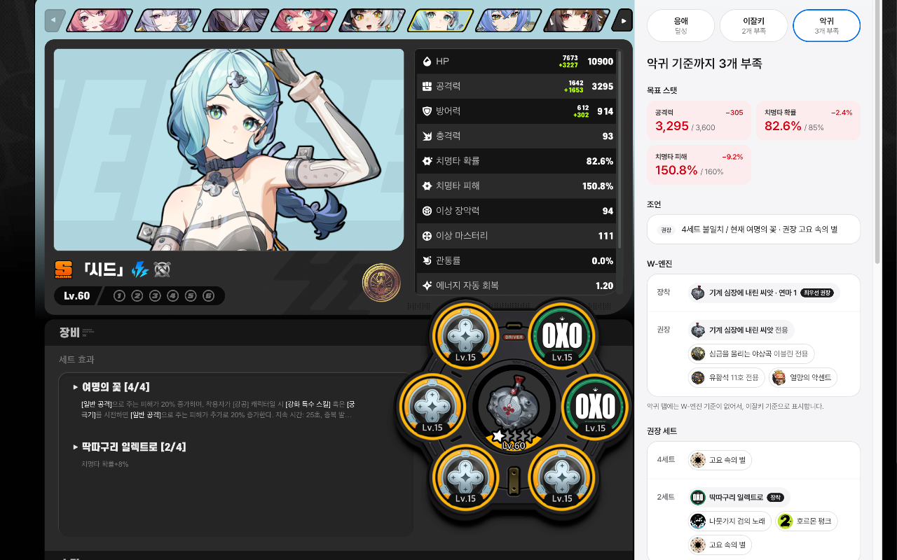

<div align="center">
  
  <h1>ZZZ 디스크 페어리</h1>
  <a href="https://chromewebstore.google.com/detail/jjmgmcmclnplkihipekfgngnjfckklca"></a>
  <a href="https://chromewebstore.google.com/detail/jjmgmcmclnplkihipekfgngnjfckklca"></a>
  <a href="https://developer.chrome.com/docs/extensions/mv3/intro/"></a>
  <p align="center">
    
</p>
  <p>젠레스 존 제로(ZZZ) 에이전트가 장착한 디스크를 평가해 주는 크롬 확장 프로그램입니다.</p>
</div>

## 무엇을 알려주나요?

HoYoLAB 전적 페이지에서 에이전트를 클릭하면, 화면 오른쪽에 평가 패널이 나타납니다.  
패널에서는 아래 내용을 확인할 수 있습니다.

- 디스크 6개에 각각 매긴 점수 (우수 / 양호 / 보통 / 교체 후보)
- 디스크마다 그대로 쓸지, 교체할지, 새 디스크에서 어떤 부옵션을 챙겨야 하는지
- 주옵션이 권장 옵션과 일치하는지 여부
- 권장하는 2세트·4세트와 현재 장착한 세트의 비교
- 장착한 W-엔진이 시트 권장 엔진인지, 몇 순위인지, 교체를 고려해야 하는지
- 목표 스탯(치명타, 관통 등)에 도달하려면 얼마나 더 필요한지
- 스킬 레벨이 시트 권장 레벨에 도달했는지, 다음에 어떤 스킬을 올리면 되는지

평가 기준은 [ZZZ 세팅 시트](https://docs.google.com/spreadsheets/d/1C3ZpKCTQJXFwUBgZKZRdLOvGqDGlVijb/edit?gid=2007866856#gid=2007866856)를 따르며, 시트 제작자에게 허락을 받아 사용하고 있습니다.

<p align="center">
  
</p>

## 설치 방법

크롬 웹 스토어 등록은 아직 준비 중입니다. 지금은 압축 파일을 내려받아 직접 설치합니다.

1. 이 저장소 페이지에서 **Code → Download ZIP**을 눌러 파일을 내려받고 압축을 풉니다.
2. 크롬 주소창에 `chrome://extensions`를 입력해서 확장 프로그램 관리 페이지를 엽니다.
3. 오른쪽 위의 **개발자 모드**를 켭니다.
4. **압축해제된 확장 프로그램을 로드합니다** 버튼을 누르고, 압축을 푼 폴더 안의 `extension` 폴더를 선택합니다.

이렇게 설치한 확장 프로그램은 자동으로 업데이트되지 않습니다. 새 버전을 쓰려면 ZIP 파일을 다시 내려받아 같은 위치에 덮어쓴 다음, 확장 프로그램 관리 페이지에서 새로고침 버튼을 누릅니다.

## 사용 방법

1. [HoYoLAB 전적 페이지](https://act.hoyolab.com/app/zzz-game-record/)에 접속합니다. 확장 프로그램 아이콘을 누르고 **전적 보러 가기**를 눌러도 됩니다. 페이지가 이미 열려 있었다면 새로고침합니다.
2. 에이전트 목록에서 확인하고 싶은 에이전트를 클릭합니다.
3. 오른쪽에 나타난 패널에서 평가 결과를 확인합니다.

### 전체 에이전트 분석

보유한 에이전트를 한 번에 확인하고 싶을 때 사용합니다.

1. 확장 프로그램 아이콘을 누르고 **전체 에이전트 분석**을 누릅니다. 전적 페이지에서 패널을 보고 있다면 패널 위쪽의 **전체 분석** 버튼을 눌러도 됩니다. 이때는 패널에서 보던 에이전트가 선택된 상태로 열립니다.
2. 전적 페이지가 열리고, 리포트 탭이 그 옆에서 에이전트 정보를 불러옵니다. 확장 프로그램을 업데이트하기 전에 열어 둔 전적 페이지는 자동으로 새로고침합니다.
3. 다 불러오면 리포트 탭으로 자동으로 넘어갑니다.
4. 왼쪽 목록에서 에이전트를 고르면 패널과 같은 평가 화면이 오른쪽에 표시됩니다. 목록은 게임의 에이전트 목록처럼 한 줄에 4명씩 초상화로 표시하며, 초상화 오른쪽 위의 주황 숫자는 교체할 디스크 수, 이름 아래는 목표 스탯 달성 여부입니다.

에이전트마다 주소(`report.html#에이전트id`)가 달라서 뒤로 가기로 이전 에이전트에 돌아갈 수 있습니다. HoYoLAB에 로그인되어 있어야 하며, 로그인되어 있지 않으면 20초 뒤에 안내 문구가 표시됩니다.

### 패널 조작

패널 상단에서는 평가 기준이 되는 등급을 바꿀 수 있습니다. 패널 왼쪽 가장자리를 드래그하면 폭을 넓힐 수 있고, 두 번 클릭하면 원래 폭으로 돌아갑니다.

| 등급 | 의미 |
|---|---|
| 응애 | 입문자에게 맞춘 기준 |
| 이잘키 | 일반적인 기준선 |
| 악귀 | 고점을 노리는 기준 |

## 점수는 어떻게 계산하나요?

부옵션이 쓸모 있는 옵션으로 몇 번 강화되었는지를 셉니다.

- 해당 에이전트에게 유효한 부옵션이 1회 강화되면 1점을 줍니다.
- 후순위 부옵션이나 깡 공격력/체력/방어력이 1회 강화되면 0.5점을 줍니다.
- 합계가 **6점 이상이면 우수**, 4점 이상이면 양호, 2.5점 이상이면 보통으로 표시하고, 그보다 낮으면 교체 후보로 표시합니다.

디스크 카드 아래에는 그 디스크에 대한 안내가 붙습니다.

- 4~6번 주옵션이 시트 권장과 다르면 먼저 교체하라고 안내하고, 새 디스크에 필요한 주옵션을 알려 줍니다.
- 교체 후보나 보통 디스크에는 지금 디스크에 빠진 유효 부옵션과 쓸모없는 부옵션 개수를 알려 줍니다.
- **추천 주옵**은 4~6번 슬롯에서 시트가 권장하는 주옵션입니다. 지금 장착한 주옵션이면 ✓ 칩, 주옵션이 틀렸다면 노려야 할 주옵션을 점선 칩으로 표시합니다. 1~3번은 주옵션이 고정이라 표시하지 않습니다.
- **추천 부옵**은 그 에이전트에게 유효한 부옵션입니다. 지금 디스크에 붙어 있으면 ✓ 표시가 있는 칩으로, 없으면 점선 칩으로 표시합니다. 주옵션과 같은 스탯은 부옵션으로 붙지 않으므로 슬롯마다 목록에서 뺍니다.

## 개인정보와 안전성

에이전트를 클릭해서 보는 패널은 HoYoLAB 서버에 별도의 요청을 보내지 않습니다. 전적 페이지가 원래 불러오는 데이터를 그대로 읽어서 평가합니다.

전체 에이전트 분석을 누를 때만, 전적 페이지가 아직 불러오지 않은 에이전트의 상세 정보를 HoYoLAB에 요청합니다. 이 요청은 전적 페이지가 에이전트를 클릭할 때 보내는 요청과 같은 주소와 형식입니다. 먼저 요청 하나로 모두 받아 보고, 빠진 에이전트만 한 번에 2개씩 다시 요청합니다.

어떤 경우에도 정보는 사용자의 브라우저 안에서만 처리하며, 개발자나 제3자에게 전송하지 않습니다.


---

### 파일 구성

```
extension/                 크롬 확장 (이 폴더를 그대로 zip해서 배포)
├── manifest.json
├── inject.js              페이지가 받아오는 avatar/info 응답을 복사해서 content.js에 전달, 전체 리포트용 수집
├── content.js             평가를 실행하고 오른쪽 패널을 그림 (Shadow DOM), report.html에서는 리포트 화면
├── evaluator.js           평가 엔진 (주옵·세트·W-엔진 판정, 유효 강화 횟수, 디스크별 안내, 목표 스탯)
├── report.html            전체 에이전트 리포트 탭
├── popup.html, popup.js   툴바 아이콘 팝업 (전적 페이지 열기, 전체 에이전트 분석, 버전 표시)
├── icons/                 확장 아이콘 (16/32/48/128px)
└── data/                  자동 생성 데이터 (직접 수정하지 않음)
    ├── benchmark.js       시트 기준 데이터 (tools/convert.py로 생성)
    ├── suit-icons.js      디스크 세트 이름 → 이미지 URL (HoYoWiki)
    └── engine-icons.js    W-엔진 이름 → 이미지 URL (HoYoWiki)
images/                    README용 이미지
├── fairy-128.png          페어리 아이콘 (128px)
├── panel-screenshot.png   전적 페이지에 패널이 열린 화면
└── store-promo-440x280.png  웹 스토어 홍보 이미지
tools/convert.py           시트(xlsx) → extension/data/benchmark.js 변환
test/
├── run.js                 테스트 (배포 전에 CI에서 실행)
├── names.js               API 이름 ↔ 시트 이름 매칭 확인
├── audit.js, sweep.js     시트 전체 파싱·평가 점검 (결과 출력용)
└── fixture-avatar-vellina.json  테스트용 avatar/info 응답
```
